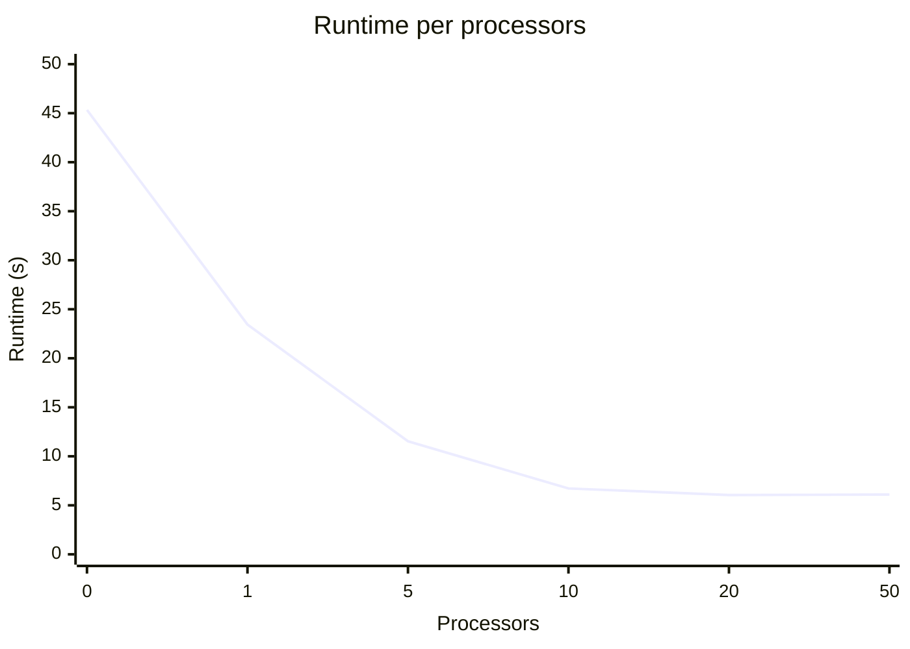

## Mandel Fractels
# Desc
this program comes in 2 parts. Week 11 with creating 50 fractels images using forking to speed up the process. Then week 12 using threading to pipeline the image creating.
# Week 11
This occured more trouble than I origanaly thought it would. The mandel program is simple to use and after having trouble to use a for loop to create a variable file name I was able to stitch together the mandel movie. The next hurdle was a variable number of child process. I struggled with a good way to write this without using a mile long and overconvulated switch and if case. This led to a switch of calling the mandel program instead of creating the image in the manmovie program. first started with execl and simplified the process. In the end, the program continously creates a child program until the it has reached the number of process given. (will default to 1 if none are given)
# stats
runtime against the number of processers given

# Week 12
This section using threads to cut down the runtime of compute_image
# stats
runtime against the number of processers given
```mermaid
xychart-beta
    title "Runtime per threads"
    x-axis "Threads" [1, 2, 5, 10, 20]
    y-axis "Runtime (s)" 0 --> 2
    line [1.976, 1.645, 1.327, 1.111, 0.664]
```
